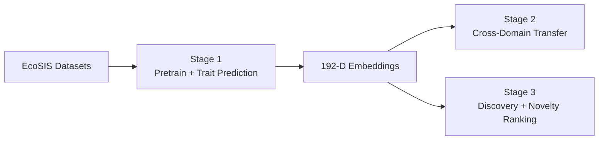
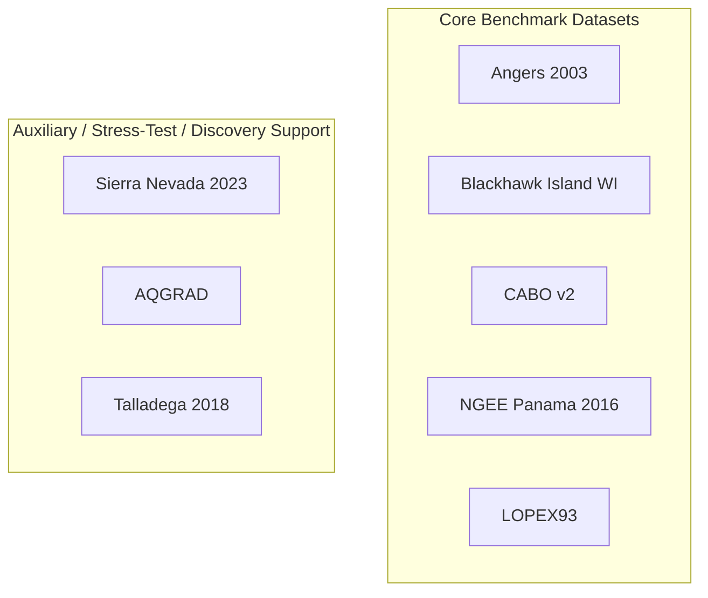

# Leaf2Traits: Hyperspectral Leaf Analysis with Deep Learning

A multi-stage machine learning pipeline for analyzing hyperspectral leaf reflectance
spectra from eight public EcoSIS plant databases. The pipeline trains a self-supervised
autoencoder, predicts biochemical leaf traits, evaluates cross-domain transfer across
all eight datasets, and discovers spectrally unusual candidate plants.



---

## Project Structure

```text
.
|-- ecosis_loaders.py              # EcoSIS API loader (AQGRAD, Talladega, Angers, Blackhawk, CABO, NGEE Panama, LOPEX, Sierra)
|-- step1_pretrain_downstream.py   # Stage 1: Autoencoder pretraining + downstream tasks
|-- step2_transfer_learning.py     # Stage 2: Cross-domain transfer
|-- step3_integrated_discovery.py  # Stage 3: Integrated discovery pipeline
|-- requirements.txt
|-- package.json
`-- README.md
```

### Outputs

```text
outputs/
|-- stage1/
|   |-- autoencoder_loss.png
|   |-- embedding_pca.png
|   |-- trait_compare_LOPEX93_<trait>.png
|   |-- trait_compare_Angers2003_<trait>.png
|   |-- trait_compare_BlackhawkIslandWI_<trait>.png
|   |-- trait_compare_SierraNevada_<trait>.png
|   |-- trait_compare_CABOv2_<trait>.png
|   |-- trait_compare_NGEEPanama_<trait>.png
|   |-- trait_regression_summary_LOPEX93.csv
|   |-- trait_regression_summary_Angers2003.csv
|   |-- trait_regression_summary_BlackhawkIslandWI.csv
|   |-- trait_regression_summary_SierraNevada.csv
|   |-- trait_regression_summary_CABOv2.csv
|   |-- trait_regression_summary_NGEEPanama.csv
|   |-- encoder.pt
|   |-- scaler_mean.npy
|   |-- scaler_std.npy
|   |-- target_wl.npy
|   `-- embeddings_all.npz
|-- stage2/
|   |-- baseline_comparison.png
|   `-- transfer_summary.csv
`-- stage3/
    |-- novelty_distribution.png
    |-- novelty_species_ranking.png
    |-- ranked_candidates.csv
    |-- trait_comparison.png
    |-- trait_comparison_summary.csv
    `-- embedding_validation.png
```

Each stage clears only its own output folder before writing new artifacts, so stale
plots from prior runs do not mix with current results.

---

## Datasets

| Name | Year | Source | Description |
|---|---|---|---|
| AQGRAD | 2021 | EcoSIS | Leaf spectra and traits along a water-affinity gradient in Mantua lakes, Italy |
| Talladega 2018 | 2018 | EcoSIS | Leaf reflectance and foliar traits from Talladega National Forest, Alabama |
| Angers 2003 | 2003 | EcoSIS | Leaf optical properties database with pigments, water content, mass per area, SPAD, and structure traits |
| Blackhawk Island WI | n.d. | EcoSIS | Seasonal fresh leaf spectra with species labels and inline chlorophyll-a and LMA traits |
| CABO 2018-2019 v2 | 2023 update | EcoSIS | Broad multispecies leaf-level spectra with inline trait metadata |
| NGEE Tropics Panama 2016 | 2019 | EcoSIS | Leaf spectral reflectance from Panama with species labels and leaf structural/chemical traits |
| LOPEX93 | 1993 | JRC / EcoSIS | Lab spectra with biochemical traits provided by the EcoSIS `metadata=true` export |
| Sierra Nevada 2023 | 2023 | EcoSIS | Field spectra with measured traits from California; retained as an auxiliary stress-test dataset rather than a core benchmark |

AQGRAD, Angers, Blackhawk, CABO, the NGEE Panama dataset, LOPEX93, and Sierra Nevada use EcoSIS `metadata=true` exports so
their trait and taxonomy fields come directly from the API. Talladega still falls
back to the local metadata CSV only if the richer EcoSIS export is unavailable.



---

## Setup

```bash
pip install -r requirements.txt
```

Optional on Windows with DirectML:

```bash
python -m pip install torch-directml
```

## Running the Pipeline

```bash
python step1_pretrain_downstream.py
python step2_transfer_learning.py
python step3_integrated_discovery.py
```

---

## Stage 1

`step1_pretrain_downstream.py` downloads all eight datasets, preprocesses spectra onto
a shared 400-2400 nm grid, trains the autoencoder, extracts 192-dimensional
embeddings, and compares three supervised views for trait regression:
raw spectra, frozen unsupervised embeddings, and a multitask supervised probe
trained on the embedding space within each dataset split.

LOPEX93 is evaluated with sample aggregation and species-held-out splits using the
trait and `Sample_#` fields returned by EcoSIS. CABO trait regression uses the full
normalized EcoSIS trait set, including structural, pigment, biochemical, and
elemental traits when present. The Angers dataset adds a compact leaf optical
benchmark with pigments, water thickness, SPAD, and structure parameter targets.
The Blackhawk dataset adds a seasonal benchmark with inline chlorophyll-a and
LMA traits. The NGEE Panama dataset adds tropical leaf-level
reflectance with species labels and leaf structural/chemical traits such as
`LMA_gDW_m2`, `CNratio`, `Cmass_pc`, `Nmass_pc`, and `H20_pc`.

Sierra Nevada remains in the pipeline as an auxiliary stress-test dataset. It is
useful for checking robustness on a small field dataset, but it should not be treated
as a primary benchmark when comparing representation quality across the project.

The encoder artifact saved to `outputs/stage1/encoder.pt` remains the unsupervised
autoencoder. The multitask probe is used only inside Stage 1 evaluation so Stage 2
transfer and Stage 3 novelty analysis do not leak trait labels into the shared
representation.

## Stage 2

`step2_transfer_learning.py` measures pairwise dataset separability using raw spectra
and learned embeddings. High accuracy here indicates strong domain differences between
datasets rather than easy transfer.

## Stage 3

`step3_integrated_discovery.py` reloads the trained encoder, rebuilds the pooled
dataset, compares trait performance again, and ranks unusual candidate species by
embedding-space novelty with a small hyperaccumulator-genus prior.

Stage 3 now evaluates trait regression separately within each dataset instead of
pooling canonical trait names across datasets. For novelty ranking, it fits
Isolation Forest within each dataset, normalizes novelty scores to `[0, 1]` per
dataset, combines those normalized scores across datasets, and ranks species by
their 95th percentile novelty rather than a single maximum scan. Species-level
ranking is then confidence-adjusted using scan count so one-off spectra do not
dominate the headline list. This reduces both cross-dataset domain bias and
small-sample volatility in the candidate list.

---

## Autoencoder

- Input: 201-band spectrum sampled every 10 nm from 400 to 2400 nm
- Encoder: 201 -> 1024 -> 512 -> 256 -> 128 -> 192
- Decoder: symmetric mirror back to 201 bands
- Latent space: 192-dimensional embedding
- Training: 140 epochs, batch size 64, learning rate `7.5e-4`, weight decay `1e-5`,
  Gaussian input noise `std=0.03`

## Preprocessing

1. Savitzky-Golay smoothing with window `11` and polynomial order `3`
2. Standard normal variate normalization
3. Linear interpolation to the shared 400-2400 nm grid

## Discovery

- Isolation Forest with 200 trees on the learned embeddings
- Novelty is scored within each dataset and normalized to `[0, 1]` before combining
- Ranking uses 95th percentile novelty per species instead of max novelty
- Species scores are confidence-adjusted by scan count using `1 - exp(-n_spectra / 5)`
- Final ranking score = confidence-adjusted novelty + hyperaccumulator-genus prior

---

## Dataset Citations

- AQGRAD: Villa P., Dalla Vecchia A., Piaser E. and Bolpagni R.. 2020-2024. *Leaf reflectance and traits of plants sampled along a water affinity gradient (AQGRAD).* Data set. Available on-line [[http://ecosis.org]](http://ecosis.org) from the Ecological Spectral Information System (EcoSIS). `10.21232/xYgn5GKv`
- Talladega: Aaron G. Kamoske Kyla M. Dahlin Shawn P. Serbin and Scott C. Stark. 2018. *2018 Talladega National Forest: Leaf level Reflectance Spectra and Foliar Traits.* Data set. Available on-line [[http://ecosis.org]](http://ecosis.org) from the Ecological Spectral Information System (EcoSIS). `10.21232/kRB5Gjgi`
- CABO: Shan Kothari, Rosalie Beauchamp-Rioux, Florence Blanchard, Anna L. Crofts, Alize Girard, Xavier Guilbeault-Mayers, Paul W. Hacker, Juliana Pardo, Anna K. Schweiger, Sabrina Demers-Thibeault, Anne Bruneau, Nicholas C. Coops, Margaret Kalacska, Mark Vellend and Etienne Lalibert. 2022. *CABO 2018-2019 Leaf-Level Spectra v2.* Data set. Available on-line [[http://ecosis.org]](http://ecosis.org) from the Ecological Spectral Information System (EcoSIS). `10.21232/58kApoRy`
- Angers 2003: S. Jacquemound, L. Bidel, C. Francois, G. Pavan. 2003. *ANGERS Leaf Optical Properties Database (2003).* Data set. Available on-line [[http://ecosis.org]](http://ecosis.org) from the Ecological Spectral Information System (EcoSIS).
- Blackhawk Island WI: Adam Chlus and Philip A. Townsend. *Seasonal fresh leaf spectra and traits, Blackhawk Island, WI.* Data set. Available on-line [[http://ecosis.org]](http://ecosis.org) from the Ecological Spectral Information System (EcoSIS).
- NGEE Panama: Shawn Serbin, Kim Ely, Alistair Rogers, Turin Dickman, Matteo Detto, Jin Wu, Brett Wolfe, Nate McDowell, Charlotte Grossiord, Sean Michaletz, Adam Collins. 2019. *NGEE Tropics Leaf Spectral Reflectance Measured in Panama Collected February to April 2016.* Data set. Available on-line [[http://ecosis.org]](http://ecosis.org) from the Ecological Spectral Information System (EcoSIS). `http://dx.doi.org/10.15486/ngt/1478523`
- LOPEX93: B. Hosgood S. Jacquemound G. Andreeoli J. Verdebout A. Pedrini G. Schmuck. 1993. *Leaf Optical Properties Experiment Database (LOPEX93).* Data set. Available on-line [[http://ecosis.org]](http://ecosis.org) from the Ecological Spectral Information System (EcoSIS).
- Sierra Nevada: Cecilia Vanden Heuvel, Natalie Queally, Ting Zheng, Laura Berman, Zach Breuer, Joel Cryer, Callan Lapinskas, Annabelle Majerus, Elliott Marsh and Philip Townsend. 2023. *Fresh Leaf Spectra and Measured Traits from the Sierra Nevada (CA) in July 2023.* Data set. Available on-line [[http://ecosis.org]](http://ecosis.org) from the Ecological Spectral Information System (EcoSIS)
