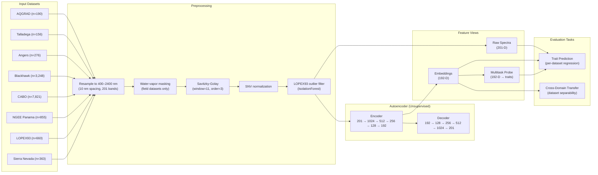
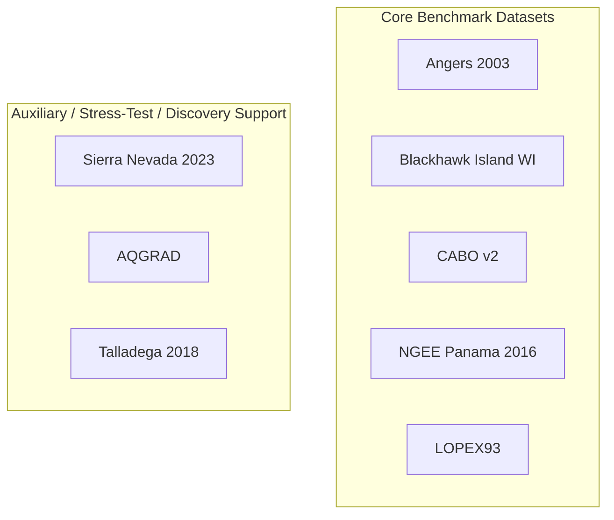

# Leaf2Traits: Hyperspectral Leaf Analysis with Deep Learning

A multi-stage machine learning pipeline for analyzing hyperspectral leaf reflectance
spectra from eight public EcoSIS plant databases. The pipeline trains a self-supervised
autoencoder, predicts biochemical leaf traits, evaluates cross-domain transfer across
all eight datasets, and discovers spectrally unusual candidate plants.



---

## Project Structure

```text
.
|-- ecosis_loaders.py              # EcoSIS API loader (AQGRAD, Talladega, Angers, Blackhawk, CABO, NGEE Panama, LOPEX, Sierra)
|-- step1_pretrain_downstream.py   # Stage 1: Autoencoder pretraining + downstream tasks
|-- step2_transfer_learning.py     # Stage 2: Cross-domain transfer
|-- step3_integrated_discovery.py  # Stage 3: Integrated discovery pipeline
|-- requirements.txt
|-- package.json
`-- README.md
```

### Outputs

```text
outputs/
|-- stage1/
|   |-- autoencoder_loss.png
|   |-- embedding_pca.png
|   |-- trait_compare_LOPEX93_<trait>.png
|   |-- trait_compare_Angers2003_<trait>.png
|   |-- trait_compare_BlackhawkIslandWI_<trait>.png
|   |-- trait_compare_SierraNevada_<trait>.png
|   |-- trait_compare_CABOv2_<trait>.png
|   |-- trait_compare_NGEEPanama_<trait>.png
|   |-- trait_regression_summary_LOPEX93.csv
|   |-- trait_regression_summary_Angers2003.csv
|   |-- trait_regression_summary_BlackhawkIslandWI.csv
|   |-- trait_regression_summary_SierraNevada.csv
|   |-- trait_regression_summary_CABOv2.csv
|   |-- trait_regression_summary_NGEEPanama.csv
|   |-- latent_sweep.png              # (with --sweep)
|   |-- latent_sweep_summary.csv      # (with --sweep)
|   |-- encoder.pt
|   |-- scaler_mean.npy
|   |-- scaler_std.npy
|   |-- target_wl.npy
|   `-- embeddings_all.npz
|-- stage2/
|   |-- baseline_comparison.png
|   `-- transfer_summary.csv
`-- stage3/
    |-- novelty_distribution.png
    |-- novelty_species_ranking.png
    |-- ranked_candidates.csv
    |-- trait_comparison.png
    |-- trait_comparison_summary.csv
    `-- embedding_validation.png
```

Each stage clears only its own output folder before writing new artifacts, so stale
plots from prior runs do not mix with current results.

---

## Datasets

| Dataset | n spectra | n samples | n species | Biome / setting | Instrument | Spectral range | Traits available | Split group | n after outlier filtering |
|---|---:|---:|---:|---|---|---|---|---|---:|
| AQGRAD | 190 | 190 | 13 | Water-affinity gradient, Mantua lakes, Italy | Field leaf-clip spectrometer | 400-2400 nm | Species labels and foliar traits | `Species` | 190 |
| Talladega 2018 | 156 | 156 | 10 | Talladega National Forest, Alabama, USA | Field leaf-clip spectrometer | 400-2400 nm | Species labels and foliar traits | `Sample_ID` | 156 |
| Angers 2003 | 276 | 276 | 43 | Laboratory leaf optical properties database | Laboratory spectrometer / integrating sphere | 400-2400 nm | Carotenoid, chlorophyll a, chlorophyll a+b, chlorophyll b, EWT, LMA, SPAD, structure parameter | `Sample_#` | 276 |
| Blackhawk Island WI | 3248 | 3248 | 10 | Seasonal fresh leaves, Blackhawk Island, Wisconsin, USA | Field leaf-clip spectrometer | 400-2400 nm | `chl_a_mmol_m2`, `lma_g_m2` | `Species` | 3248 |
| CABO 2018-2019 v2 | 7821 | 7821 | 103 | Broad multispecies leaf-level trait library | Field leaf-level spectrometer | 400-2400 nm | LMA, EWT, LDMC, C/N ratio, pigments, cellulose, hemicellulose, lignin, solubles, and multiple elemental traits | `Sample_ID` | 7821 |
| NGEE Tropics Panama 2016 | 855 | 855 | 48 | Tropical leaf reflectance, Panama | Field leaf-clip spectrometer | 400-2400 nm | CNratio, Cmass_pc, H20_pc, LMA_gDW_m2, LWP_bar, Nmass_pc, SLA_cm2_gDW | `Sample_ID` | 855 |
| LOPEX93 | 660 | 325 | 46 | Laboratory leaf optical properties database | Laboratory spectrometer / integrating sphere | 400-2400 nm | Chlorophyll a+b, EWT, LMA, protein, cellulose, carotenoid | `Species` | 640 |
| Sierra Nevada 2023 | 363 | 363 | 15 | Field spectra, Sierra Nevada, California, USA | Field leaf-clip spectrometer | 400-2400 nm | `LMA_g_m2`, `LWC_percent`, `Chlorophyll_mg_m2` | `sample_number` | 363 |

AQGRAD, Angers, Blackhawk, CABO, the NGEE Panama dataset, LOPEX93, and Sierra Nevada use EcoSIS `metadata=true` exports so
their trait and taxonomy fields come directly from the API.

LOPEX93 is the only dataset that uses sample-level aggregation for supervised regression; its `n samples` value reflects the aggregated units used for modeling, while the scan counts shown above are the raw export and the post-filter total.



---

## Setup

```bash
pip install -r requirements.txt
```

Optional on Windows with DirectML:

```bash
python -m pip install torch-directml
```

## Running the Pipeline

```bash
python step1_pretrain_downstream.py
python step2_transfer_learning.py
python step3_integrated_discovery.py
```

### Latent Dimension Sweep

To evaluate the effect of latent dimension on reconstruction and downstream performance:

```bash
python step1_pretrain_downstream.py --sweep
```

This trains autoencoders with latent dimensions [8, 16, 32, 64, 128, 192] and outputs:
- `outputs/stage1/latent_sweep_summary.csv` — reconstruction MSE and mean LMA R² per dimension
- `outputs/stage1/latent_sweep.png` — dual-axis plot of MSE vs R²

---

## Stage 1

`step1_pretrain_downstream.py` downloads all eight datasets, preprocesses spectra onto
a shared 400-2400 nm grid, trains the autoencoder, extracts 192-dimensional
embeddings, and compares three supervised views for trait regression:
raw spectra, frozen unsupervised embeddings, and a multitask supervised probe
trained on the embedding space within each dataset split.

## Stage 2

`step2_transfer_learning.py` measures pairwise dataset separability using raw spectra
and learned embeddings. High accuracy here indicates strong domain differences between
datasets rather than easy transfer.

## Stage 3

`step3_integrated_discovery.py` reloads the trained encoder, rebuilds the pooled
dataset, compares trait performance again, and ranks unusual candidate species by
embedding-space novelty with a scan-count adjustment to reduce small-sample bias.

---

## Autoencoder

- Input: 201-band spectrum sampled every 10 nm from 400 to 2400 nm
- Encoder: 201 -> 1024 -> 512 -> 256 -> 128 -> 192
- Decoder: symmetric mirror back to 201 bands
- Latent space: 192-dimensional embedding
- Training: 140 epochs, batch size 64, learning rate `7.5e-4`, weight decay `1e-5`,
  Gaussian input noise `std=0.03`

### Latent Dimension Selection

The latent dimension was selected via a sweep over [8, 16, 32, 64, 128, 192]:

| Latent dim | Val MSE | R² (LMA) | Δ R² from dim 8 |
|---:|---:|---:|---:|
| 8 | 0.00316 | 0.640 | — |
| 16 | 0.00150 | 0.691 | +0.051 |
| 32 | 0.00153 | 0.806 | +0.166 |
| 64 | 0.00244 | 0.833 | +0.193 |
| 128 | 0.00187 | 0.848 | +0.208 |
| 192 | 0.00202 | 0.856 | +0.216 |

Dimension 192 was retained as it yielded the highest downstream performance (R² = 0.856 for LMA), with the majority of gains achieved by dim 32 and diminishing returns thereafter.

## Preprocessing

Spectra were standardized to the same 400-2400 nm wavelength space at 10 nm spacing, yielding 201 bands per scan. For field datasets (Sierra Nevada, Talladega, NGEE Panama), the ~1350-1450 nm and ~1800-1950 nm water-vapor absorption regions were masked and replaced by linear interpolation from adjacent valid bands. The spectra were further smoothed using the Savitzky-Golay method (window length 11, polynomial order 3), scaled using standard normal variate normalization (SNV), and wavelength-aligned to the standard wavelength space.

Additionally, LOPEX93 outliers were filtered using Isolation Forest (Contamination = 0.03, n_estimators = 100, random_state = 42), reducing the influence these outliers had on the learned representation. Datasets with multiple scans per biological sample were grouped during downstream evaluation to reduce leakage between train and test splits. Sample-level aggregation was used for LOPEX93 trait prediction when appropriate.

## Trait Harmonization

Cross-dataset trait comparisons require harmonized names and units. The following traits were harmonized across datasets with unit conversions to SI units:

| Harmonized trait | Target unit | Datasets |
|---|---|---|
| `LMA_g_cm2` | g/cm² | LOPEX93, Angers, CABO, NGEE Panama, Sierra Nevada, Blackhawk |
| `Chlorophyll_a_b_ug_cm2` | µg/cm² | LOPEX93, Angers |
| `EWT_g_cm2` | g/cm² | LOPEX93, Angers, CABO |
| `Carotenoid_ug_cm2` | µg/cm² | LOPEX93, Angers |
| `LWC_percent` | % | Sierra Nevada, NGEE Panama |
| `CN_ratio` | ratio | CABO, NGEE Panama |

**Unit conversions applied:**
- LMA: g/m² → g/cm² (÷ 10,000) for CABO, NGEE Panama, Sierra Nevada, Blackhawk
- LMA: g/cm² (no conversion) for LOPEX93, Angers
- EWT, Chlorophyll, Carotenoid: already in target units for source datasets

Dataset-specific traits (e.g., SPAD, LWP, LDMC, C/N ratio, elemental traits) are retained alongside harmonized traits for within-dataset analysis. Both harmonized and dataset-specific traits are evaluated in the downstream regression pipeline.

## Discovery

- Isolation Forest with 200 trees on the learned embeddings
- Novelty is scored within each dataset and normalized to `[0, 1]` before combining
- Ranking uses 95th percentile novelty per species instead of max novelty
- Species scores are adjusted by scan count using `1 - exp(-n_spectra / 5)`
- Final ranking score = scan-count-adjusted novelty

---

## Dataset References

- AQGRAD: Villa P., Dalla Vecchia A., Piaser E. and Bolpagni R.. 2020-2024. *Leaf reflectance and traits of plants sampled along a water affinity gradient (AQGRAD).* Data set. Available on-line [[http://ecosis.org]](http://ecosis.org) from the Ecological Spectral Information System (EcoSIS). `10.21232/xYgn5GKv`
- Talladega: Aaron G. Kamoske Kyla M. Dahlin Shawn P. Serbin and Scott C. Stark. 2018. *2018 Talladega National Forest: Leaf level Reflectance Spectra and Foliar Traits.* Data set. Available on-line [[http://ecosis.org]](http://ecosis.org) from the Ecological Spectral Information System (EcoSIS). `10.21232/kRB5Gjgi`
- CABO: Shan Kothari, Rosalie Beauchamp-Rioux, Florence Blanchard, Anna L. Crofts, Alize Girard, Xavier Guilbeault-Mayers, Paul W. Hacker, Juliana Pardo, Anna K. Schweiger, Sabrina Demers-Thibeault, Anne Bruneau, Nicholas C. Coops, Margaret Kalacska, Mark Vellend and Etienne Lalibert. 2022. *CABO 2018-2019 Leaf-Level Spectra v2.* Data set. Available on-line [[http://ecosis.org]](http://ecosis.org) from the Ecological Spectral Information System (EcoSIS). `10.21232/58kApoRy`
- Angers 2003: S. Jacquemound, L. Bidel, C. Francois, G. Pavan. 2003. *ANGERS Leaf Optical Properties Database (2003).* Data set. Available on-line [[http://ecosis.org]](http://ecosis.org) from the Ecological Spectral Information System (EcoSIS).
- Blackhawk Island WI: Adam Chlus and Philip A. Townsend. *Seasonal fresh leaf spectra and traits, Blackhawk Island, WI.* Data set. Available on-line [[http://ecosis.org]](http://ecosis.org) from the Ecological Spectral Information System (EcoSIS).
- NGEE Panama: Shawn Serbin, Kim Ely, Alistair Rogers, Turin Dickman, Matteo Detto, Jin Wu, Brett Wolfe, Nate McDowell, Charlotte Grossiord, Sean Michaletz, Adam Collins. 2019. *NGEE Tropics Leaf Spectral Reflectance Measured in Panama Collected February to April 2016.* Data set. Available on-line [[http://ecosis.org]](http://ecosis.org) from the Ecological Spectral Information System (EcoSIS). `http://dx.doi.org/10.15486/ngt/1478523`
- LOPEX93: B. Hosgood S. Jacquemound G. Andreeoli J. Verdebout A. Pedrini G. Schmuck. 1993. *Leaf Optical Properties Experiment Database (LOPEX93).* Data set. Available on-line [[http://ecosis.org]](http://ecosis.org) from the Ecological Spectral Information System (EcoSIS).
- Sierra Nevada: Cecilia Vanden Heuvel, Natalie Queally, Ting Zheng, Laura Berman, Zach Breuer, Joel Cryer, Callan Lapinskas, Annabelle Majerus, Elliott Marsh and Philip Townsend. 2023. *Fresh Leaf Spectra and Measured Traits from the Sierra Nevada (CA) in July 2023.* Data set. Available on-line [[http://ecosis.org]](http://ecosis.org) from the Ecological Spectral Information System (EcoSIS)
